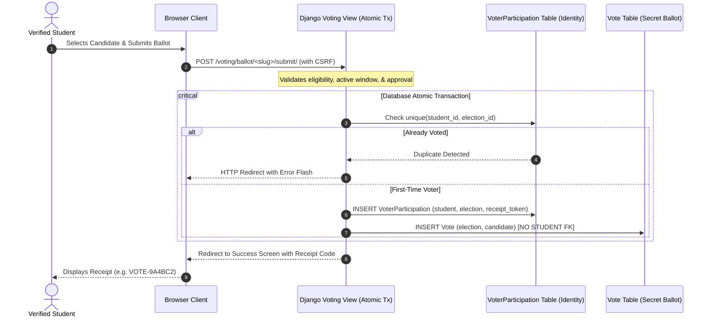

# 🏛️ Apex College Voting Management System

A production-grade, responsive, and secure **College Voting Management System** built with **Python 3**, **Django**, **Bootstrap 5.3**, and **SQLite**. 

This system was engineered as a portfolio project to demonstrate institutional full-stack development, database-level concurrency control, role-based authorization, and democratic secret ballot architecture.

---

## 📌 Table of Contents

1. [Key Features](#-key-features)
2. [Technology Stack](#-technology-stack)
3. [System Architecture & Privacy Model](#-system-architecture--privacy-model)
4. [Database Models & ER Relationships](#-database-models--er-relationships)
5. [Installation & Local Setup](#-installation--local-setup)
6. [Seed Demo Data](#-seed-demo-data)
7. [Automated Test Suite](#-automated-test-suite)
8. [Demo Evaluation Credentials](#-demo-evaluation-credentials)
9. [Interview Q&A Guide](#-how-to-explain-this-project-in-an-interview)
10. [Security Limitations & Future Roadmap](#-security-limitations--future-roadmap)

---

## ✨ Key Features

### 1. 🛡️ Administrator Operations Console
- **Custom Admin Dashboard:** Sidebar navigation, responsive layout, and real-time KPI metrics (Total Students, Pending Approvals, Total Candidates, Active Polls, Ballots Cast).
- **Student Verification Workflow:** View new registrations, verify college credentials, one-click Approve or Reject with audit reasons, and suspend/activate accounts.
- **Election Scheduling & Governance:** Create, update, or cancel elections. Schedule automated voting windows with start/end datetimes, manually toggle polls open/closed, and publish or hide certified results.
- **Candidate Management:** Register candidates per election with official photos, roll numbers, academic departments, contesting offices (President, Vice President, General Secretary, etc.), and platform manifestos.
- **Electoral Analytics & Reports:** Department-wise voter turnout, position standings, and print-ready official election tally certificates.

### 2. 🗳️ Verified Student Voting Portal
- **Streamlined Registration:** Server-side validation enforcing unique student roll numbers, college email addresses, and secure password hashing.
- **Account Verification Status:** Clear contextual alerts indicating whether an account is Verified, Pending Admin Approval, or Rejected.
- **Interactive Ballot Booth:** Review contesting candidates, read platforms, and select candidates with interactive cards and confirmation dialogs.
- **Anti-Fraud & One-Vote Enforcement:** Database-level uniqueness constraints and atomic ACID transactions strictly prevent duplicate voting.
- **Anonymous Ballot Receipts:** Every voter receives a unique digital verification token (e.g. `VOTE-8F3A29B1`) proving participation without revealing candidate choice.
- **Voting Participation History:** Inspect all elections participated in and historical receipts.

### 3. 🌐 Public Information Portal
- **Modern Institutional Landing Page:** Hero section, live polling ticker, system features, and a 4-step workflow guide.
- **Election Directory:** Browse active polls, scheduled upcoming elections, and past contests.
- **Certified Results Archive:** View dynamic vote tallies, turnout percentages, and clear winner/tie indicators for elections published by the commission.
- **Institutional Governance & About:** Explains democratic election rules, student representation, and contact help desk.

---

## 💻 Technology Stack

| Layer | Technologies |
|---|---|
| **Backend Framework** | Python 3.13 / Django 6.0 |
| **Frontend Styling** | HTML5, CSS3, Bootstrap 5.3.3, Custom Institutional Theme |
| **Iconography** | Bootstrap Icons 1.11.3 |
| **Client Interaction** | Vanilla JavaScript (ES6+) for card selection, clipboard copying, and confirmation modals |
| **Database** | SQLite (development) / PostgreSQL compatible |
| **Authentication** | Django Auth System with PBKDF2 Password Hashing |
| **Form Processing** | Django ModelForms with server-side validation |
| **Testing** | Django TestCase & Client (22 Automated Tests) |

---

## 🔐 System Architecture & Privacy Model

A core principle of democratic voting is the **Secret Ballot**. The system decouples voter identity from individual candidate choices while maintaining strict auditability:



### Architectural Key Points:
1. **`VoterParticipation` Ledger:** Records *that* Student A voted in Election X to enforce the 1-vote limit via a database unique constraint `unique_together = ('student', 'election')`.
2. **`Vote` Ballot Box:** Records an anonymized vote for Candidate C in Election X. **It has no foreign key to the student or user record.**
3. **Receipt Code:** An anonymous token (`VOTE-XXXXXXXXXX`) returned to the student so they can independently verify their participation without compromising ballot secrecy.

---

## 🗄️ Database Models & ER Relationships

- **`CustomUser` (extends `AbstractUser`):**
  - `student_id` (CharField, unique=True, indexed)
  - `email` (EmailField, unique=True)
  - `department` (CSE, IT, ECE, ME, CE, EE, MBA, BSC)
  - `year_of_study` (1st, 2nd, 3rd, 4th, PG)
  - `role` (`student`, `admin`)
  - `approval_status` (`pending`, `approved`, `rejected`)
  - `approved_by` (FK to CustomUser)
  - `approval_date`, `rejection_reason`, `profile_photo`

- **`Election`:**
  - `title`, `slug`, `description`
  - `start_date`, `end_date` (DateTimeField)
  - `status` (`draft`, `active`, `closed`)
  - `is_published` (BooleanField - controls result visibility)
  - `created_by` (FK to CustomUser)

- **`Candidate`:**
  - `election` (FK to Election)
  - `name`, `student_id`, `department`
  - `position` (President, Vice President, General Secretary, etc.)
  - `manifesto` (TextField)
  - `photo` (ImageField with 5MB validation)

- **`VoterParticipation`:**
  - `student` (FK to CustomUser)
  - `election` (FK to Election)
  - `receipt_code` (CharField, unique=True)
  - `voted_at` (DateTimeField)
  - `Meta: unique_together = ('student', 'election')`

- **`Vote` (Secret Ballot):**
  - `election` (FK to Election)
  - `candidate` (FK to Candidate)
  - `cast_at` (DateTimeField)
  - *(Zero reference to User/Student)*

---

## 🚀 Installation & Local Setup

### Prerequisites
- Python 3.10+ (tested on Python 3.13)
- Git

### Step-by-Step Instructions

1. **Clone the repository:**
   ```bash
   git clone https://github.com/your-username/college-voting-system.git
   cd college-voting-system
   ```

2. **Create and activate a virtual environment:**
   - **Windows PowerShell:**
     ```powershell
     python -m venv venv
     .\venv\Scripts\Activate.ps1
     ```
   - **macOS / Linux:**
     ```bash
     python3 -m venv venv
     source venv/bin/activate
     ```

3. **Install dependencies:**
   ```bash
   pip install -r requirements.txt
   ```

4. **Run database migrations:**
   ```bash
   python manage.py makemigrations accounts elections candidates voting
   python manage.py migrate
   ```

5. **Seed the database with complete evaluation data:**
   ```bash
   python manage.py seed_data
   ```

6. **Start the local development server:**
   ```bash
   python manage.py runserver
   ```
   Open your browser and navigate to: **`http://127.0.0.1:8000/`**

---

## 🧪 Automated Test Suite

The system includes **22 comprehensive unit and integration tests** covering registration, login, role permissions, election scheduling, candidate validation, duplicate voting rejection, atomic race-condition prevention, and winner/tie outcome calculations.

Run the test suite with:
```bash
python manage.py test
```

Expected output:
```text
Creating test database for alias 'default'...
......................
----------------------------------------------------------------------
Ran 22 tests in 65.713s

OK
Destroying test database for alias 'default'...
```

---

## 🔑 Demo Evaluation Credentials

The `seed_data` command populates the database with realistic evaluation accounts:

| Role | Username / ID | Password | Status / Notes |
|---|---|---|---|
| **Administrator** | `admin` | `Admin@12345` | Chief Election Officer (Full access to Admin Console) |
| **Approved Student** | `CS2023001` | `Student@12345` | Jordan Hayes (Verified voter - eligible to vote) |
| **Approved Student** | `CS2023002` | `Student@12345` | Priya Sharma (Has already voted in live election) |
| **Approved Student** | `EC2023015` | `Student@12345` | Marcus Vance (Verified voter - eligible to vote) |
| **Pending Student** | `IT2024099` | `Student@12345` | Liam Chen (Pending approval - voting locked) |
| **Rejected Student** | `CE2024005` | `Student@12345` | David Kim (Registration rejected by admin) |

---

## 💬 How to Explain This Project in an Interview

When interviewing for a software engineering or Python/Django role, use this structure:

### 1. Elevator Pitch
> *"I designed and built the College Voting Management System—a full-stack web application engineered in Python, Django, and Bootstrap 5 to modernize collegiate student union elections. It solves the operational challenges of paper ballots by introducing an administrative credential verification queue, automated election time windows, strict database concurrency to eliminate double voting, and an architectural separation of voter identity from secret ballot records."*

### 2. Deep Dive: Race Conditions & Double Voting Prevention
> **Interviewer:** *"How did you prevent a student from opening two browser tabs and voting twice simultaneously?"*  
> **Your Answer:**  
> *"I implemented defense-in-depth across three layers:*  
> *1. **Form & View Layer:** Checked voter eligibility prior to rendering the ballot.*  
> *2. **ACID Transaction Boundary:** Wrapped the submission inside `django.db.transaction.atomic()`.*  
> *3. **Database Uniqueness Constraint:** The `VoterParticipation` model has a strict database composite unique constraint on `(student, election)`. Even if two concurrent HTTP POST requests bypass view-level checks simultaneously, the database engine enforces serialization and throws an `IntegrityError`, which my view catches gracefully."*

### 3. Deep Dive: Voter Privacy & Ballot Secrecy
> **Interviewer:** *"How do you guarantee that administrators cannot see who voted for whom?"*  
> **Your Answer:**  
> *"I decoupled voter participation from ballot choices. The `VoterParticipation` table stores only the student and the election with a verification receipt token. The actual `Vote` record stores the candidate and election without any foreign key to the student. Therefore, neither the ordinary dashboard nor database queries can link a specific student to their candidate choice."*

### 4. Handling Edge Cases & Tie Outcomes
> **Interviewer:** *"How are election results calculated and what happens in a tie?"*  
> **Your Answer:**  
> *"Results are computed dynamically using Django ORM aggregation (`Count('votes')`). My results service identifies the maximum vote count and checks if multiple candidates share the top tally. If a tie occurs, the system displays an explicit 'Tie Detected' banner listing both tied candidates, preventing erroneous single winner declarations."*

---

## 🔒 Security Limitations & Future Roadmap

### Demo Scope & Cryptographic Limitations
- **Academic Portfolio Scope:** This application provides architectural separation between voter ledger and ballots suitable for university elections. It does **not** employ Zero-Knowledge Proofs (ZKPs) or homomorphic encryption found in national election-grade systems.
- **Timing Correlation:** In very low-traffic databases, an attacker with raw database root access could theoretically correlate `VoterParticipation.voted_at` and `Vote.cast_at` timestamps if submitted in isolation. (Future mitigation: asynchronous shuffled batch queueing via Celery/Redis).

### Future Roadmap
1. **Multi-Factor Authentication (MFA):** Add TOTP / SMS OTP verification for student logins.
2. **Multi-Position Ballots:** Support single-election ballots electing multiple offices (President, VP, Secretary) simultaneously.
3. **Asynchronous Ballot Shuffling:** Introduce Celery background workers to shuffle and insert votes with randomized latency to eliminate timestamp correlation.
4. **Audit Log Export:** Provide signed CSV/PDF cryptographic audit packages for campus observers.

---

## 📄 License & Attribution

Developed with ❤️ for academic and portfolio demonstration. Distributed under the MIT License.
# College_Voting_2.0

